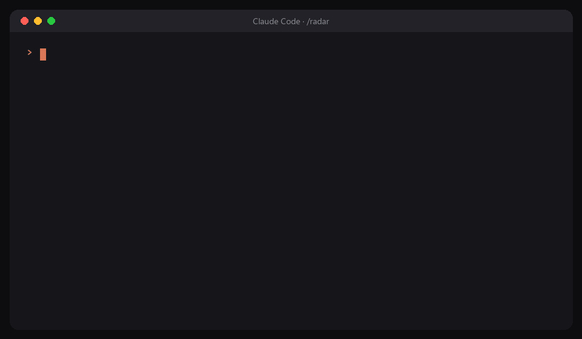

# /radar

**Español** | [English](README.en.md)

<p align="center">
  
</p>

<p align="center">
  <a href="https://github.com/AldoP4/radar-oportunidades/actions/workflows/validate.yml"></a>
  
  
</p>

**Deja de preguntarle a la IA "¿qué negocio pongo?" y que te conteste lo mismo que a todos.**

`/radar` es una skill para Claude Code (y otros agentes) que encuentra **oportunidades de negocio que existen hoy, para ti**, y te dice cómo cobrarlas: quién compra, por qué ahora, cuánto se paga ya, cómo llegas a ese cliente en 7 días y cómo probarlo antes de programar una sola línea.

```
/plugin marketplace add AldoP4/radar-oportunidades
/plugin install radar@radar-oportunidades
```

Luego escribe `/radar` (o `/radar:radar` si lo instalaste como plugin), o simplemente pregúntale a Claude *"¿qué puedo vender con lo que sé?"*.

No necesita llaves, cuentas ni configuración: usa la búsqueda web que tu agente ya tiene.

---

## El problema

Le pides ideas de negocio a una IA y te pasan tres cosas:

1. **No sabe qué día es.** Te habla de "tendencias de 2024" o de una ley que ya entró en vigor, porque cree que vive en la fecha de sus datos de entrenamiento.
2. **Te da ideas genéricas.** "Una app de IA para pymes." ¿Quién paga? ¿Cuánto? ¿Dónde lo encuentras?
3. **No te dice si alguien va a pagar.** Y lo único que importa de una idea es si alguien va a pagar por ella.

## Qué hace /radar

```
/radar dev en México con Claude Code, sin capital, no me gusta salir a visitar
```

1. **Reloj.** Ancla la fecha real con la computadora y calcula cuánto falta para cada fecha límite. Nada de "recientemente" inventado.
2. **Tu perfil.** Qué sabes hacer, cuánto tiempo y dinero tienes, qué no quieres hacer y cuánto quieres ganar. La misma idea es buena para uno y mala para otro.
3. **Señales de "por qué ahora"** en 7 tipos: leyes con fecha, cambios de plataformas, capacidades nuevas de IA, quejas que se repiten, dinero que ya se gasta, temporadas y huecos que se abren. En tu idioma y tu país.
4. **8 a 15 candidatos**, escritos como *"Para [comprador] que [dolor] porque [por qué ahora]: [lo que entregas]"*.
5. **Un filtro duro.** Una rúbrica de 7 criterios con pesos, donde lo que más cuenta es **"¿alguien ya paga por esto?"** y **"¿puedes llegar al comprador en 7 días?"**, más reglas de descarte, abogado del diablo y pre-mortem.
6. **El top 3, a fondo:** comprador y dónde está, competencia y precios, escalera de precio, qué confianza necesita el cliente, cómo llegar a él y una **prueba de 7 días** para vender antes de construir.

Te deja un reporte `radar-AAAA-MM-DD.md` y, en el chat, **la única acción que debes hacer hoy.**

👉 Reportes reales de ejemplo: [dev en México](ejemplos/radar-2026-11-18-mexico.md) · [diseñadora freelance en Argentina](ejemplos/radar-2026-11-20-argentina-diseno.md).

## Otros usos

```
/radar nicho: escuelas privadas en Colombia
/radar validar: checador de asistencia por WhatsApp
/radar diseñadora freelance en Argentina, 10 horas a la semana
```

- **Antes de construir algo:** valida tu idea con `validar:` y sal con una prueba de 7 días.
- **Para encontrar a quién venderle lo que ya sabes hacer.**
- **Para hacer contenido:** cada señal con fecha es un video ("faltan 44 días para…").

## En qué se basa

No es una lista de ideas: es un método armado con lo que la gente que encuentra y vende oportunidades hace en la práctica. Cada pieza dice de dónde viene en [metodologias.md](skills/radar/references/metodologias.md):

- *Por qué ahora* (Sequoia) · ideas orgánicas y "lo tedioso que nadie quiere hacer" (Paul Graham)
- Sigue el dinero y la escalera de productos (Rob Walling) · trabajos por hacer (Christensen y Moesta)
- *The Mom Test* (Rob Fitzpatrick) · preventa (Noah Kagan) · supuesto más riesgoso (Eric Ries)
- Ecuación de valor (Alex Hormozi) · pre-mortem (Gary Klein) · distribución primero

## Reglas que sigue

- **Nada inventado:** cada cifra lleva su link, y lo que no encuentra lo dice.
- Separa **"hay demanda"** de **"te van a comprar a ti"**.
- Nunca promete ingresos. Habla de señales y de pruebas.
- Si no hay una buena oportunidad para tu perfil, te lo dice.

## Instalación

**Claude Code (recomendado, se actualiza solo):**
```
/plugin marketplace add AldoP4/radar-oportunidades
/plugin install radar@radar-oportunidades
```

**Codex, Cursor, Gemini CLI y otros agentes compatibles con [Agent Skills](https://agentskills.io):**
```
npx skills add AldoP4/radar-oportunidades -g
```

**A mano:** copia la carpeta `skills/radar` a `~/.claude/skills/radar`.

Requisitos: un agente con búsqueda web. El reloj usa Python 3.8+ y, si no lo hay, el comando `date`.

## Estructura

```
skills/radar/
├── SKILL.md                  el flujo completo
├── scripts/ahora.py          el reloj: fecha real y días que faltan
└── references/
    ├── metodologias.md       de dónde sale cada paso
    ├── fuentes.md            qué buscar para cada señal
    ├── rubrica.md            los 7 criterios y las reglas de descarte
    ├── prueba-7-dias.md      vender antes de construir
    └── plantilla-reporte.md  el formato del reporte
```

## Contribuir

¿Tu país tiene fuentes que faltan? ¿Encontraste una oportunidad con /radar y la probaste? Abre un issue o un PR: ver [CONTRIBUTING.md](CONTRIBUTING.md). Los reportes de resultados reales (funcionó o no) son lo que más ayuda a mejorar la rúbrica.

## Quién lo hizo

Lo hice yo, [Aldo Pazzi](https://github.com/AldoP4), desde Puebla, México, con Claude Code. Lo armé porque yo mismo le preguntaba a la IA qué construir y me daba ideas que no podía vender. En [Nuvver](https://nuvver.org) automatizamos negocios con Claude Code; si quieres que te ayudemos a llevar a la realidad una oportunidad que encontró el radar, escríbenos.

Licencia MIT.
